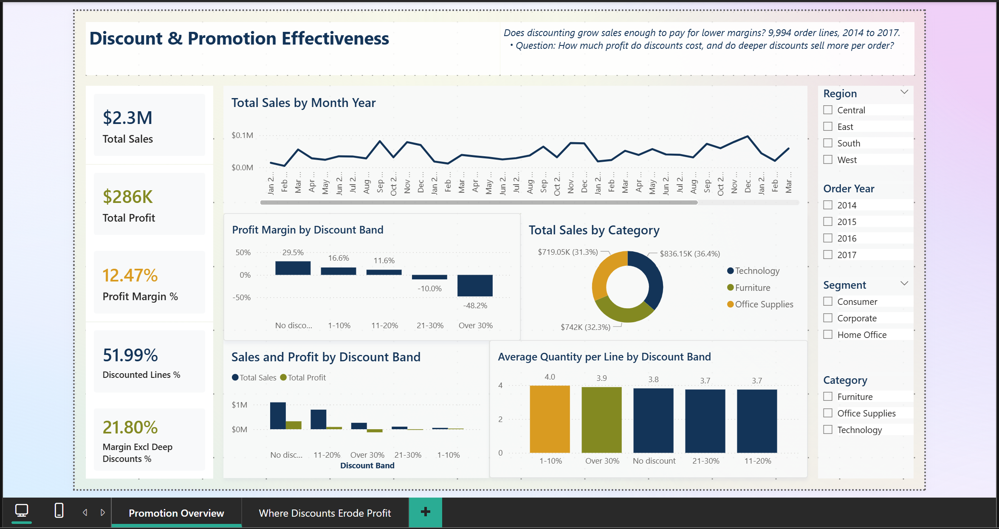

# Promotion & Discount Effectiveness Analytics


[](screenshots/01_promotion_overview.png)

*Select the image to view it at full size.*

---

## Project Overview

A two-page Power BI dashboard that tests whether discounts pay for themselves. It compares profit margin, sales volume and order size across discount levels, then shows where in the product range and across regions discounting erodes profit.

Retailers use discounts to attract customers and move volume. A discount only pays off if the extra volume covers the margin lost on every item sold at a reduced price. This project checks whether the discounts in this dataset pay off.

This is an observational analysis. Discounts were not randomly assigned, so the results describe associations, not the effect of any single promotion.

### Data Source

**Data Source:** Secondary data obtained from publicly available online sources for educational and analytical practice. The dataset was used for data preparation, analysis, dashboard development, and business insights.

---

## Headline KPIs (2014 to 2017)

| Total Sales | Total Profit | Profit Margin | Margin Excluding Discounts Over 20% |
|---|---|---|---|
| $2,297,201 | $286,397 | 12.5% | 21.8% |

*Currency: US dollars, assumed. The dataset does not state a currency.*

---

## Business Questions

1. How does profit margin change as the discount rises?
2. Do deeper discounts sell more per order line?
3. Which sub-categories and categories lose money under discounting?
4. Do discount depths differ by region, and how do they relate to margin?

---

## Dataset

| Item | Detail |
|---|---|
| Rows | 9,994 order lines, 5,009 orders, 793 customers |
| Period | 3 January 2014 to 30 December 2017 |
| Key fields | Sales, Profit, Discount, Quantity, Category, Sub-Category, Segment, Region, Ship Mode |
| Discount values | 0% to 80%. 52.0% of lines have a discount |
| Duplicates and nulls | None |

### Limitations of the data
- **Not an experiment.** Discounts were not randomly assigned, so associations may reflect which products or customers were discounted.
- **Profit is as provided.** The dataset has no separate cost, promotion or marketing spend fields, so return on promotion spend cannot be calculated.
- **One dataset.** Results describe this data only.

---

## Data Model and Preparation

- Sales, Profit, Discount, Quantity and Order Date are used as provided.
- Calculated column **Discount Band**: No discount, 1–10%, 11–20%, 21–30%, Over 30%.
- Calculated column **Discount Band Order**, used to sort the bands in the correct sequence.
- Deep discount is any discount above 20%.

---

## KPI Definitions

| KPI | Definition |
|---|---|
| Profit Margin | Total profit ÷ total sales |
| Discounted Lines % | Share of order lines with a discount above 0% |
| Avg Quantity per Line | Average units per order line |
| Average Order Value | Total sales ÷ number of distinct orders |
| Deep Discount Margin | Profit ÷ sales for lines with a discount above 20% |
| Margin Excluding Deep Discounts | Margin on all lines except those with a discount above 20% |

Full measure definitions are in [`documentation/measures.dax`](documentation/measures.dax).

---

## Key Findings

All figures come from the dataset. They describe patterns, not causes.

1. **Margin falls steeply as discounts rise.** Lines with no discount earn a 29.5% margin. Lines with 1–10% earn 16.6%, lines with 11–20% earn 11.6%, lines with 21–30% lose money (−10.0%), and lines above 30% lose 48.2%.

2. **Deep discounts make a loss.** Lines discounted above 20% make up 13.9% of lines and 15.8% of sales, but they produce a loss of $135,376. Their margin is −37.3%. Without them, the margin would be 21.8%.

3. **Deeper discounts do not sell more per line.** The average quantity per line is 3.81 with no discount and 3.86 with discounts above 20%. In this dataset, discounts do not appear to increase order size.

4. **The pattern holds within each category.** Margin falls as the discount rises in all three categories:
   - Furniture: 22.7% with no discount, falling to −45.8% above 30%.
   - Technology: 34.0% with no discount, falling to −27.4% above 30%.
   - Office Supplies: 29.5% with no discount, falling to −119.3% above 30%. This category has no lines in the 21–30% band.

   Discount depth matters within categories, not only product mix.

5. **Three sub-categories lose money overall.** Tables lose $17,725 (margin −8.6%, with 55% of its lines discounted above 20%). Bookcases lose $3,473 (−3.0%), and Supplies lose $1,189 (−2.5%). The other 14 sub-categories are profitable.

6. **Central region discounts more and earns less.** Its average discount is 24.0% and its margin is 7.9%. The West averages 10.9% and earns 14.9%. The East (14.5%, 13.5%) and South (14.7%, 11.9%) sit in between.

7. **Segment differences are small.** Consumer, Corporate and Home Office have margins of 11.5%, 13.0% and 14.0%. Their average discounts are within 1.1 points of each other.

### Suggested actions (for discussion, not tested)

- Set a discount ceiling near 20% for most products, and allow deeper discounts only for clearance, with a set end date.
- Review pricing and discount policy for Tables, Bookcases and Supplies before the next promotion.
- Review discount depth in the Central region, where the average is highest and margin lowest.
- Run a controlled test, for example 10% against 20% discounts on the same product set, and measure margin and quantity, not sales alone.

---

## Dashboard

The Power BI report has two pages.

| Page | Purpose |
|---|---|
| **Promotion Overview** | Headline KPIs, sales and margin by month, margin by discount band, sales and profit by band, and average quantity per line by band. Slicers: region, year, segment, category |
| **Where Discounts Erode Profit** | Profit by sub-category, margin by category and discount band, discount depth and margin by region. Slicers: segment, category, year |

---

## Tools and Techniques

- **Power BI:** calculated columns for discount bands, DAX measures for margin and deep-discount analysis, a matrix with conditional formatting, and slicers.
- **DAX measures** are in [`documentation/measures.dax`](documentation/measures.dax).

---

## Repository Structure

```text
promotion-discount-effectiveness-analytics/
├── README.md
├── dashboard/
│   └── promotion_discount_dashboard.pbix
├── data/
│   └── sales_data.csv
├── documentation/
│   └── measures.dax
└── screenshots/
    ├── 01_promotion_overview.png
    └── 02_where_discounts_erode_profit.png
```

---

## How to View

1. Open `dashboard/promotion_discount_dashboard.pbix` in Power BI Desktop.
2. If a file error appears, point the source to `data/sales_data.csv` (Home > Transform data > Data source settings).

---

## Disclaimer

This is a portfolio project using secondary data. Results describe that dataset only and do not represent any retailer's actual promotion performance.

---

**Author:** [Sarthak Jaykar](https://www.linkedin.com/in/sarthak-jaykar/)
